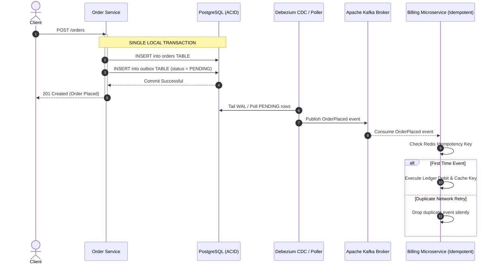

# Distributed Event Streaming & Transactional Outbox Blueprint

An architectural blueprint demonstrating the **Transactional Outbox Pattern**, **Change Data Capture (CDC)**, and **Idempotent Consumer Deduplication** in distributed microservice architectures.

---

## Architectural Mechanics: Eliminating the Dual-Write Bug



---

## Code Simulation

```bash
python3 Web-Applications/Architecture-Blueprints/Distributed-Event-Streaming-Architecture/outbox_pattern_simulator.py
```
Outputs confirmation of the atomic write, Kafka dispatch, and automated duplicate delivery suppression.
