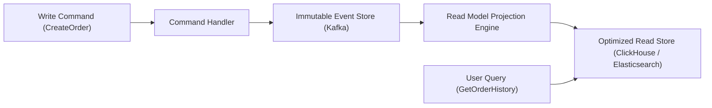

# Suggested Projects & Roadmaps: High-Scale Software Engineering

Architectural roadmaps and technical designs for high-throughput distributed systems, event sourcing, and global resilience.

---

## 1. CQRS & Event Sourcing with Apache Kafka & ClickHouse

### Executive Summary
Decouples write models (high-speed transactional updates) from read models (columnar analytical queries). Every state mutation is saved as an immutable event in the append-only event store, allowing complete auditability, time-travel debugging, and zero-downtime projection rebuilding.

---

## 2. Distributed Saga Pattern for Distributed Multi-Service Transactions

### Executive Summary
Replaces blocking Two-Phase Commit (2PC) protocols with Choreographed or Orchestrated Sagas across microservices. If an order placement succeeds but payment processing or inventory reservation fails, the Saga orchestrator automatically fires compensating transactions to restore eventual consistency.
