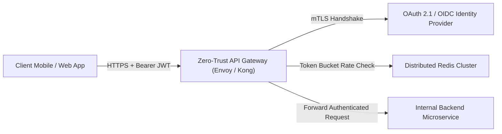

# Zero-Trust Distributed API Gateway Blueprint

An enterprise architecture specification for high-throughput **Zero-Trust API Gateways**, featuring **Token Bucket & Sliding Window Rate Limiting**, **Mutual TLS (mTLS)** proxying, and **OAuth 2.1 Token Introspection**.

---

## Gateway Topology



---

## Rate Limiting Mechanics (Token Bucket)

- **Continuous Fractional Refill:** Instead of naive discrete periodic resets, the bucket calculates fractional token refill using the wall-clock timestamp difference:
$$\text{Tokens}_{\text{new}} = \min(\text{Capacity}, \text{Tokens}_{\text{old}} + \Delta t \times \text{RefillRate})$$
- **RFC 6585 Compliance:** Responds with standard rate limiting headers: `X-RateLimit-Limit`, `X-RateLimit-Remaining`, and `Retry-After`.

---

## Execution

```bash
python3 Web-Applications/Architecture-Blueprints/Zero-Trust-API-Gateway/token_bucket_rate_limiter.py
```
Outputs live rate limit enforcement and HTTP 429 rejection behavior.
